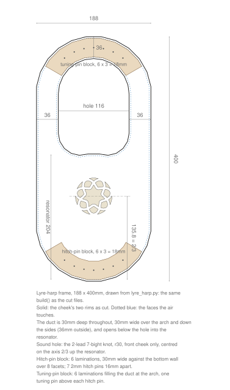
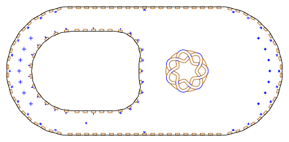

# Lyre-harp

**[Read the writeup](https://gernreich.github.io/lyre-harp/)** ·
**[Turn it in 3D](https://gernreich.github.io/lyre-harp/lyre-harp-bore30-188x400mm/lyre-harp-bore30-188x400mm.html)**

A seven-string lyre-harp frame, 188 × 400mm, built as **one closed duct** between two
flat cheeks. Over the arch and down the sides the duct is 30 × 30mm; below the string
hole it opens across the whole gap to the outer wall, and that air is the resonator.
Output is millimetre-true — `1 user unit = 1 mm` with a physical `width`/`height` — so
it prints and cuts at real size.

<table>
<tr>
<td align="center"><a href="lyre-harp-drawing.svg"></a></td>
</tr>
<tr>
<td align="center"><sub>lyre-harp-drawing.svg · the review drawing, not a cut file</sub></td>
</tr>
</table>

Built for **[LaserMadeMusic](https://www.youtube.com/@LaserMadeMusic)**, where the cutting
and assembly are shown.

**[The rest of the build files](https://gernreich.github.io/)** — every instrument,
generator and tool, indexed.

**[Download everything as a ZIP](https://github.com/Gernreich/lyre-harp/archive/refs/heads/main.zip)**

## The frame

The two walls are drawn independently, not offset from one centreline. The outside is a
stadium: a half-circle at each end joined by parallel sides. The string hole has a
half-circle top concentric with the outer one, parallel sides, and a bottom of two
rounded corners with a small bump rising between them. Where the walls run a bore
apart the duct is square; below the hole they part, and the duct stays 30mm deep,
cheek to cheek, but runs **203.7mm** along the axis.

**49 wall panels** stand between the cheeks: 25 round the string hole and 24 round the
outside, each numbered, with the same number engraved beside its slot.

**The sound hole** is the 2-lead 7-bight knot from
**[knotwork-soundholes](https://gernreich.github.io/knotwork-soundholes/)**, radius 30mm,
placed unchanged in the front cheek on the long axis, two thirds of the way up the
resonator: 135.8mm from its bottom. The back cheek is plain, so the cheeks are two
parts, each cut once.

**Seven strings, 16mm apart.** Two blocks of six 3mm laminations, 18mm deep, give the
pins something to bite into, since 3mm of ply will not hold one under tension:

- the **hitch-pin block** lies against the bottom wall over 8 facets, 30mm wide from it;
- the **tuning-pin block** fills the duct over the arch, wall to wall, across 120°.

Each tuning pin stands in line with its hitch pin across the instrument.

## What is on the sheets

Measured out of the files, not copied from whatever drew them. Every sheet fits a
600 × 308mm bed; the largest is 593 × 208mm.

| Sheet | Size | What is on it |
|---|---|---|
| `lyre-harp-bore30-188x400mm-narrow-cheek-a-cut-files.svg` | 419.8 × 208.0mm | the front cheek: 49 slots, the knot, the pin marks |
| `lyre-harp-bore30-188x400mm-narrow-cheek-b-cut-files.svg` | 419.8 × 208.0mm | the back cheek: 49 slots |
| `lyre-harp-bore30-188x400mm-narrow-panels-cut-files.svg` | 593.3 × 136.4mm | the 49 wall panels, numbered |
| `lyre-harp-bore30-188x400mm-narrow-hitch-block-cut-files.svg` | 404.3 × 178.0mm | six hitch-block laminations |
| `lyre-harp-bore30-188x400mm-narrow-tuning-block-cut-files.svg` | 404.2 × 178.0mm | six tuning-block laminations |

All of them are in `lyre-harp-bore30-188x400mm/cut-files/`.

Run the colours **blue, orange, black**: blue engraves, orange cuts the slots and the
knot's waste, black frees the part. Only the two cheeks have an orange stage; the
panels and the laminations are blue and black. That is the sequence every LaserMadeMusic
repository uses — blue engraves, then green → orange → cyan → black, black always the
cut that frees the part. These sheets have no green or cyan stage.

<table>
<tr>
<td align="center"><a href="lyre-harp-bore30-188x400mm/cut-files/lyre-harp-bore30-188x400mm-narrow-cheek-a-cut-files.svg"></a></td>
</tr>
<tr>
<td align="center"><sub>cheek A · 419.8 × 208.0mm sheet</sub></td>
</tr>
</table>

*Click it to download the cut file. This is a display rendering — the cut file draws a
hairline on no background, which a browser shows almost invisibly. Orange is darkened in
the picture; at full strength it is too pale to read against a white ground. The cut
file keeps the exact value.*

## Before you cut

**Cut it in 3mm Baltic birch plywood.** The slots are drawn for a 3mm sheet at a
**0.13mm kerf**, measured, and the finger joints are drawn tighter than that — as if
the kerf were **0.25mm** — so they close with a rubber mallet rather than a thumb. The
joints are press-fit; shellac seals the air gaps.

Three test sheets come first if your laser or your ply is not the one these were tuned
on:

| Sheet | What it tells you |
|---|---|
| `KERF-TEST-3mm-ply.svg` | your kerf: ten cuts across a strip, and a square hole against the piece that fell out of it |
| `lyre-harp-bore30-188x400mm-narrow-FIT-LADDER-cut-files.svg` | the fit: one joint drawn at 0.15, 0.18, 0.21, 0.24 and 0.27, each coupon engraved with its value in hundredths |
| `lyre-harp-bore30-188x400mm-narrow-test-arch-4toA-cut-files.svg` | a slice of the arch, 17 parts, to stand up before committing a whole frame |

**The pin marks are engraved, not cut.** A hole in the cheek alone would not guide a
drill on into the block behind it, so each hitch pin is a 2mm circle with a cross
through it, and each tuning pin is a cross alone: its diameter is yours to choose, and
a circle drawn at a guess would read as the hole to drill.

**The laminations are glued**, in number order, into each block.

**`lyre-harp-bore30-188x400mm-narrow-cheek-a-BACK-FACE-numbers-engrave-only.svg` has no cut line in it.** It
puts the 49 slot numbers on the back of cheek A, mirrored, for dropping the panels in
from that side. Cut cheek A first, turn it over **about its long axis** — the 400mm
one, so the sound hole stays at the same end — lay it in the same place and run this.
Turned end for end instead, the numbers miss: the string hole is not symmetric that
way.

**No acoustic claim is made.** The strings, the pins and the tuning are not in these
files — this is the frame.

## Regenerating it

Everything here is drawn by
**[`lyre_harp.py`](https://github.com/Gernreich/trumpet-elbows-allowed/blob/main/parts/bore/concept/swept-curve/lyre_harp.py)**
in trumpet-elbows-allowed, which shares the panel, slot and sheet code of that
repository's ribbon bores. With both repositories cloned side by side, from this one:

```sh
G=../trumpet-elbows-allowed/parts/bore/concept/swept-curve/lyre_harp.py
python3 $G --no-write                     # run the checks, write nothing
python3 $G --out=DIR/lyre-harp-bore30-188x400mm-narrow.svg     # the five sheets
python3 $G --fit=0.21 --out=DIR/lyre-harp-bore30-188x400mm-narrow.svg
```

`--fit=` redraws the joints at another fit and moves nothing else; the
kerf stays the measured one. The checks — panels clear of each other, every engraving
on its part, the sound hole over the resonator, the pins in their blocks, every sheet
on the bed — run on every write and stop it when one fails. `.repro` holds the exact
command for every file here.

## Files

| | |
|---|---|
| `lyre-harp-bore30-188x400mm/cut-files/` | the five build sheets, the three test sheets and the back-face engraving |
| `lyre-harp-bore30-188x400mm/lyre-harp-bore30-188x400mm.html` | the frame in 3D, cheeks, panels and blocks, to drag round |
| `lyre-harp-drawing.svg` | the dimensioned review drawing — **not** a cut file |
| `previews/` | display renderings of the five build sheets — **not** cut files |
| `README.md` · `index.html` | this writeup and its published page; the markdown is the source |
| `.repro` | the command that draws each shipped file |

Released under [CC0 1.0](LICENSE).
