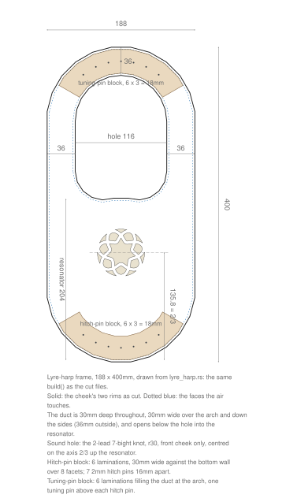
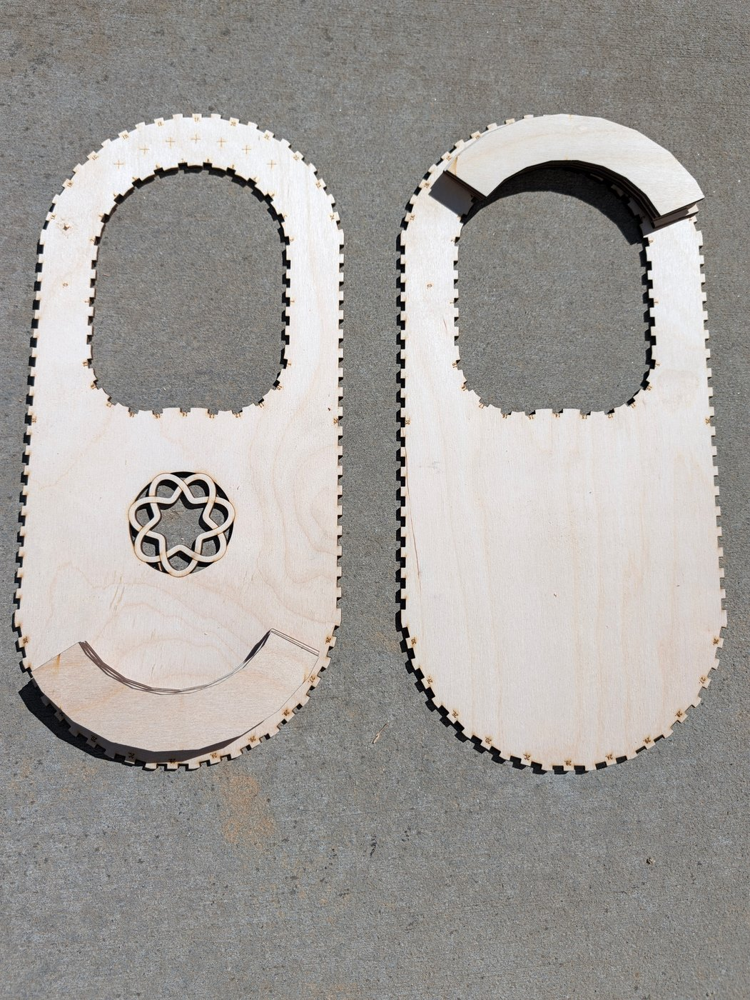
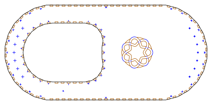

# Lyre-harp

**[← All projects](https://gernreich.github.io/)**

<!-- readme-only -->
**[Turn it in 3D](https://gernreich.github.io/lyre-harp/lyre-harp-bore30-188x400mm/lyre-harp-bore30-188x400mm.html)**

<!-- readme-only -->
**[Read the writeup](https://gernreich.github.io/lyre-harp/)**

<!-- page-only **[Read the README](https://github.com/Gernreich/lyre-harp)** · **[Turn it in 3D on a page of its own](lyre-harp-bore30-188x400mm/lyre-harp-bore30-188x400mm.html)** -->

<!-- page-only <iframe src="lyre-harp-bore30-188x400mm/lyre-harp-bore30-188x400mm.html?embed" title="The lyre-harp frame as solid parts you can drag to turn: the two cheeks, the panels and the blocks of its closed duct" style="width:100%;height:560px;border:0"></iframe> -->

A seven-string lyre-harp frame, 188 × 400 mm, built as **one closed duct** between two
flat cheeks. Over the arch and down the sides the duct is 30 × 30 mm; below the string
hole it opens across the whole gap to the outer wall, and that air is the resonator.
Output is millimetre-true — `1 user unit = 1 mm` with a physical `width`/`height` — so
it prints and cuts at real size.

<table>
<tr>
<td align="center"><a href="lyre-harp-drawing.svg"></a></td>
</tr>
<tr>
<td align="center"><sub>lyre-harp-drawing.svg · the review drawing, not a cut file</sub></td>
</tr>
</table>

**The parts are cut.** Both cheeks, with the laminations of the tuning-pin block and the
hitch-pin block stacked where each one goes. It is not assembled yet:

<p align="center"></p>

Built for **[LaserMadeMusic](https://www.youtube.com/@LaserMadeMusic)**, where the cutting
and assembly are shown.

**[The rest of the build files](https://gernreich.github.io/lasermademusic.html)** — every instrument,
generator and tool, indexed.

**[Download everything as a ZIP](https://github.com/Gernreich/lyre-harp/archive/refs/heads/main.zip)**

## The frame

The two walls are drawn independently, not offset from one centreline. The outside is a
stadium: a half-circle at each end joined by parallel sides. The string hole has a
half-circle top concentric with the outer one, parallel sides, and a bottom of two
rounded corners with a small bump rising between them. Where the walls run a bore
apart the duct is square; below the hole they part, and the duct stays 30 mm deep,
cheek to cheek, but runs **203.7 mm** along the axis.

**49 wall panels** stand between the cheeks: 25 round the string hole and 24 round the
outside, each numbered, with the same number engraved beside its slot.

**The sound hole** is the 2-lead 7-bight knot from
**[knotwork-soundholes](https://gernreich.github.io/knotwork-soundholes/)**, radius 30 mm,
placed unchanged in the front cheek on the long axis, two thirds of the way up the
resonator: 135.8 mm from its bottom. The back cheek is plain, so the cheeks are two
parts, each cut once.

**Seven strings, 16 mm apart.** Two blocks of six 3 mm laminations, 18 mm deep, give the
pins something to bite into, since 3 mm of ply will not hold one under tension:

- the **hitch-pin block** lies against the bottom wall over 8 facets, 30 mm wide from it;
- the **tuning-pin block** fills the duct over the arch, wall to wall, across 120°.

Each tuning pin stands in line with its hitch pin across the instrument.

## What is on the sheets

Measured out of the files, not copied from whatever drew them. Every sheet fits a
600 × 305 mm bed; the widest is 593.3 mm across, the tallest 208.0 mm.

| Sheet | Size | What is on it |
|---|---|---|
| `lyre-harp-bore30-188x400mm-narrow-cheek-a-cut-files.svg` | 419.8 × 208.0 mm | the front cheek: 49 slots, the knot, the pin marks |
| `lyre-harp-bore30-188x400mm-narrow-cheek-b-cut-files.svg` | 419.8 × 208.0 mm | the back cheek: 49 slots |
| `lyre-harp-bore30-188x400mm-narrow-panels-cut-files.svg` | 593.3 × 136.4 mm | the 49 wall panels, numbered |
| `lyre-harp-bore30-188x400mm-narrow-hitch-block-cut-files.svg` | 404.3 × 178.0 mm | six hitch-block laminations |
| `lyre-harp-bore30-188x400mm-narrow-tuning-block-cut-files.svg` | 404.2 × 178.0 mm | six tuning-block laminations |

All of them are in `lyre-harp-bore30-188x400mm/cut-files/`.

Run the colours **blue, orange, black**: blue engraves, orange cuts the slots and the
knot's waste, black frees the part. Only the two cheeks have an orange stage; the
panels and the laminations are blue and black. That is the sequence every LaserMadeMusic
repository uses — blue engraves, then green → orange → cyan → black, black always the
cut that frees the part. These sheets have no green or cyan stage.

<table>
<tr>
<td align="center"><a href="lyre-harp-bore30-188x400mm/cut-files/lyre-harp-bore30-188x400mm-narrow-cheek-a-cut-files.svg"></a></td>
</tr>
<tr>
<td align="center"><sub>cheek A · 419.8 × 208.0 mm sheet</sub></td>
</tr>
</table>

*Click it to download the cut file. This is a display rendering — the cut file draws a
hairline on no background, which a browser shows almost invisibly. Orange is darkened in
the picture; at full strength it is too pale to read against a white ground. The cut
file keeps the exact value.*

## Before you cut

**Cut it in 3 mm Baltic birch plywood.** The slots are drawn for a 3 mm sheet at a
**0.13 mm kerf**, measured, and the finger joints are drawn tighter than that — as if
the kerf were **0.25 mm** — so they close with a rubber mallet rather than a thumb. The
joints are press-fit; shellac seals the air gaps.

Three test sheets come first if your laser or your ply is not the one these were tuned
on:

| Sheet | What it tells you |
|---|---|
| `KERF-TEST-3mm-ply.svg` | your kerf: ten cuts across a strip, and a square hole against the piece that fell out of it |
| `lyre-harp-bore30-188x400mm-narrow-FIT-LADDER-cut-files.svg` | the fit: one joint drawn at 0.15, 0.18, 0.21, 0.24 and 0.27, each coupon engraved with its value in hundredths |
| `lyre-harp-bore30-188x400mm-narrow-test-arch-4toA-cut-files.svg` | a slice of the arch, 17 parts, to stand up before committing a whole frame |

**The pin marks are engraved, not cut.** A hole in the cheek alone would not guide a
drill on into the block behind it, so each hitch pin is a 2 mm circle with a cross
through it, and each tuning pin is a cross alone: its diameter is yours to choose, and
a circle drawn at a guess would read as the hole to drill.

**The laminations are glued**, in number order, into each block.

**`lyre-harp-bore30-188x400mm-narrow-cheek-a-BACK-FACE-numbers-engrave-only.svg` has no cut line in it.** It
puts the 49 slot numbers on the back of cheek A, mirrored, for dropping the panels in
from that side. Cut cheek A first, turn it over **about its long axis** — the 400 mm
one, so the sound hole stays at the same end — lay it in the same place and run this.
Turned end for end instead, the numbers miss: the string hole is not symmetric that
way.

**No acoustic claim is made.** The strings, the pins and the tuning are not in these
files — this is the frame.

## Regenerating it

Everything here is drawn by **`lyre_harp.rs`**, in this repository: Rust since
2026-11-07 (Python until then; the move changed no number in any file). It uses
the panel, slot and sheet code of
**[`ribbon_bore.rs`](https://github.com/Gernreich/swept-curve/blob/main/ribbon_bore.rs)**,
the generator of the [swept-curve](https://github.com/Gernreich/swept-curve)
trumpet bores, so it expects that repository cloned beside this one. From this
one:

```sh
cargo build --release
target/release/lyre_harp --no-write                     # run the checks, write nothing
target/release/lyre_harp --out=DIR/lyre-harp-bore30-188x400mm-narrow.svg     # the five sheets
target/release/lyre_harp --fit=0.21 --out=DIR/lyre-harp-bore30-188x400mm-narrow.svg
target/release/lyre_harp --solidcraft=DIR                # the SolidCraft design
```

`--fit=` redraws the joints at another fit and moves nothing else; the
kerf stays the measured one. The checks — panels clear of each other, every engraving
on its part, the sound hole over the resonator, the pins in their blocks, every sheet
on the bed — run on every write and stop it when one fails. `.repro` holds the exact
command for every file here.

## Files

| | |
|---|---|
| `lyre-harp-bore30-188x400mm/cut-files/` | the five build sheets, the three test sheets and the back-face engraving |
| `lyre-harp-bore30-188x400mm/lyre-harp-bore30-188x400mm.html` | the frame in 3D, cheeks, panels and blocks, to drag round |
| `lyre_solidcraft.rs` · `lyre-harp-bore30-188x400mm/solidcraft/` | the frame as a parametric SolidCraft design, and the design it writes |
| `lyre_harp.rs` · `lyre_harp_page.rs` | the generator: every sheet, the drawing and the 3D page, with their checks; the second holds the 3D page's browser code |
| `Cargo.toml` · `Cargo.lock` | what `cargo build --release` builds it from |
| `NOTES.md` | why the generator draws what it does, and what each check has caught |
| `lyre-harp-drawing.svg` | the dimensioned review drawing — **not** a cut file |
| `previews/` | display renderings of the five build sheets — **not** cut files |
| `photos/` | the build so far, photographed |
| `README.md` · `index.html` | this writeup and its published page; the markdown is the source |
| `.repro` | the command that draws each shipped file |

Released under [CC0 1.0](LICENSE).

## SolidCraft design

`lyre_harp --solidcraft=DIR` also writes the frame as a parametric SolidCraft design:
its size, bore, ply and fit are parameters, and every point of the frame follows them as
the generator works it out — the two outlines, the air's faces, each wall's centreline,
the cheeks' rims, all 49 panels with their mitre trims, both blocks and the knot. Open
`lyre-harp-bore30-188x400mm/solidcraft/lyre-harp-bore30-188x400mm.sc` in SolidCraft. The parameters are under
the **SOLID** tab, **MODIFY** panel, **Change Parameters**; the Browser lists the parts
and the timeline every step. `lyre-harp-bore30-188x400mm/solidcraft/lyre-harp-bore30-188x400mm.solidcraft.json`
is the script it was built from (`solidcraft-cli run FILE --save NAME.sc`). The `.sc`
holds the design without SolidCraft's build cache, which it rebuilds on opening, so it
is the same file every time.

| Parameter | Default | What it is |
|---|---|---|
| `length` · `width_k` | 400 mm · 0.4706 | the outer outline end to end, and its width per mm of length |
| `bore` | 30 mm | the duct's depth everywhere, and its width over the arch and down the sides |
| `ply` | 3 mm | every wall, cheek and lamination |
| `hole_straight` · `hole_corner` · `hole_bump` | 1.099 · 0.620 · 0.065 | the hole's straight sides, bottom corners and bump, per mm of its half-width |
| `kerf` · `fit` | 0.13 · 0.25 mm | the beam, and the kerf the joints are drawn as if cut at (`--fit=`); the mortices and the cheeks' rims follow the fit |
| `tooth` · `shoulder` · `play` | 6 · 2 · −0.035 mm | each tooth and each gap along a panel, the least of it left past its end teeth, and each mortice's play a side along its tooth (it follows the fit) |
| `knot_up` | 0.667 | the knot's centre, its share of the way from the outer wall's far end to the bump |
| `hitch_w` | 30 mm | the hitch block, in from the outer wall's face |
| `pins` · `pin_spacing` · `tune_extra` · `facet` | 7 · 16 mm · 15 mm · 15° | the tuning block's span: past the outermost pin, out to the next facet's middle |

The rest are read-only parameters, a few hundred of them: each point's `_x` and `_y`,
each face edge's normal and each vertex's mitre, each panel's trims, length and middle.
How many facets each arc has, and which facets a block starts on, are the default
build's, so they stay put while the numbers move. The panels have their teeth and
both cheeks their mortices (2026-11-09), each panel as many teeth as its length holds,
so a panel made longer gains them. The cheeks' rims are as cut: the generator draws
each rim on its mortices' outer edges with no kerf added, so the beam leaves it half a
kerf inside the line and every mortice is a notch open to the rim. The pins are left
out.

**Checked** part by part against the generator's own: all 63 parts match to within
0.001 mm, the page's rounding. Built by the generator with `--fit=0.20`, and with the
frame 420 mm long, a 28 mm bore and 3.2 mm ply, and given the same numbers, every part
matches the same way. Read back with `sc-flatten --redraw-all` and compared with the
committed cut files, all 63 parts agree: cuts within 0.026 mm, engraved marks within
0.123 mm (2026-11-09).

## STEP files

`lyre-harp-bore30-188x400mm/step/` holds the SolidCraft design, built by SolidCraft, as a STEP file to open or
import in a CAD program such as Fusion or FreeCAD: one solid body per part, in
millimetres, assembled, with no parameters. The wall panels have their teeth and the
cheeks their mortices, and the hitch and tuning pins are left out. `.repro` checks it:

```
target/release/lyre_harp --solidcraft=lyre-harp-bore30-188x400mm/solidcraft
solidcraft-cli run lyre-harp-bore30-188x400mm/solidcraft/lyre-harp-bore30-188x400mm.solidcraft.json --out lyre-harp-bore30-188x400mm/step/lyre-harp-bore30-188x400mm.step
```

The files:

- `lyre-harp-bore30-188x400mm/step/lyre-harp-bore30-188x400mm.step`

## Credits

Made by Michael Gernreich with [Claude](https://www.anthropic.com/claude) (Anthropic), working in Claude Code, which co-wrote the code and the documentation. Commits Claude made carry a `Co-Authored-By: Claude` line.
